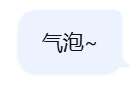
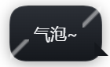
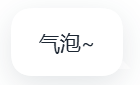
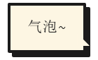

# dsh-bubble-skins · 气泡样式库

> 为 **DeepSeek Harness**（`dsh`）Web 界面提供多套可切换的**用户消息气泡样式**。
> 只接管气泡，不动整体主题 —— 换气泡这件事，从此像换 QQ 气泡一样简单。

[](./LICENSE)
[](https://github.com/deepseek-ai/deepseek-harness)

> 状态：**M1 + M1.1 已通过真机验收**（5 套皮肤、气泡尾巴开关、官方风格设置行）；
> 自定义皮肤与图片气泡见 [路线图](./docs/TECH_ROADMAP.md)。

## 特性

- 🎨 **气泡独立换肤** —— 与整体主题、壁纸、字体插件解耦，互不打架；
- 🧩 **内置多套风格** —— QQ 经典蓝、QQ 装饰气泡、毛玻璃、像素风、极简；
- ⚡ **热切换** —— 切换即时生效，无需重启 DSH；
- 🧹 **可完整还原** —— 卸载或停用后，产品默认外观原样回归；
- 📦 **零构建** —— 纯 JS + CSS，无打包器、无运行时依赖；
- 🌗 **明暗自适应** —— 每套皮肤同时定义亮色与暗色变体；
- 🐾 **尾巴可开关** —— 5 套皮肤均支持右侧小尾巴，可在设置里一键显示/隐藏。

## 内置皮肤

| 皮肤 id | 名称 | 风格 |
| --- | --- | --- |
| `qq-blue` | QQ 经典蓝 | 浅蓝底 + 右侧气泡小尾巴 |
| `qq-deco` | QQ 装饰气泡 | 深色渐变 + 两侧装饰角（参考会员气泡） |
| `glass` | 毛玻璃 | 半透明磨砂 + 细边框 |
| `pixel` | 像素风 | 直角 + 硬阴影 + 等宽字体 |
| `minimal` | 极简 | 去底色，只留文字与细分隔线 |

### 效果预览

<table>
  <tr>
    <td align="center"><br /><sub><b>QQ 经典蓝</b> · qq-blue</sub></td>
    <td align="center"><br /><sub><b>QQ 装饰气泡</b> · qq-deco</sub></td>
  </tr>
  <tr>
    <td align="center"><br /><sub><b>毛玻璃</b> · glass</sub></td>
    <td align="center"><br /><sub><b>像素风</b> · pixel</sub></td>
  </tr>
</table>

> 截图来自真机（浅色主题）；「极简」样式可在 **设置 → 通用 → 气泡样式** 中查看。
> 5 套皮肤均支持「小尾巴」，可在 **设置 → 通用 → 气泡尾巴** 独立开关。

## 安装

要求：**dsh >= 0.2.0**（本机验证基线：桌面端 `0.2.1-rc.2`）。

桌面端推荐通过应用内「插件」页安装：

1. 打开侧边栏「**插件**」→「添加插件」；
2. 输入本地目录绝对路径（如 `E:\mycode\dsh-bubble-skins`），或发布后的包名 `dsh-bubble-skins`；
3. 安装完成后按提示启用，**重启应用**（或刷新界面）即可看到效果。

命令行方式（`dsh` 版本需与目标应用一致；profile 名请按实际环境替换，例如 `desktop` 或 `web`）：

```sh
# 本地开发安装（link 模式，改动实时生效）
dsh plugin --profile <profile> add link:E:\mycode\dsh-bubble-skins

# 卸载
dsh plugin --profile <profile> remove dsh-bubble-skins
```

> 注意：桌面端 profile 由应用自己持有，某些环境下全局 `dsh` CLI 无法管理它；
> 此时请使用应用内插件页。

## 使用

安装并**重启应用**后，在 **设置 → 通用** 里可以：

- **气泡样式**：下拉选择 5 套皮肤之一，选中即生效并自动保存；
- **气泡尾巴**：开关右侧小尾巴（对所有皮肤生效，默认开启）。

也可以打开浏览器控制台切换（M1 起保留的调试能力）：

```js
// 查看可用皮肤
window.dshBubbleSkins.list

// 切换皮肤（立即生效并持久化）
window.dshBubbleSkins.set('glass')

// 查看当前皮肤
window.dshBubbleSkins.current
```

## 工作原理

本插件只做两件事，全部在客户端完成：

1. **注入作用域样式** —— 生成皮肤 CSS 时给**每一条规则**加上
   `html[data-dsh-bubble-skin="<id>"]` 前缀，覆盖形状、底色、尾巴、装饰与间距；
2. **限定命中范围** —— 只命中普通用户行、pending steering 与本地提交回声三类气泡，
   不会影响 goal 气泡、问答气泡或助手消息。

`<style>` 带 `data-plugin="dsh-bubble-skins"` 归属标记；所有资源（style 标签、根属性）都通过
`ctx.effect` 托管，插件卸载时自动清理并恢复默认外观。

> 实现细节与 DOM 钩子见 [设计文档](./docs/DESIGN.md)。

## 目录结构

```
dsh-bubble-skins/
├── package.json          # 插件清单：dsh.client / dsh.bundle.patch / icon
├── cordis.patch.yml      # 安装时向 profile 插入插件行
├── index.js              # 宿主半边（空实现，样式全部在客户端）
├── client.js             # 客户端 bundle：皮肤注册表 + 运行时（M1 核心）
├── locale/               # 中英文展示文案与皮肤文案
├── src/                  # 源码留档 / M2 皮肤模块预留
├── docs/
│   ├── screenshots/      # 效果预览图（README 引用）
│   ├── DESIGN.md         # 项目设计文档
│   └── TECH_ROADMAP.md   # 技术路线文档
├── icon.svg
└── LICENSE
```

## 开发

```sh
# 语法检查
npm run check

# 本地安装（方式见上方「安装」；会写入所选 profile，可用插件页或 remove 撤销）
dsh plugin --profile <profile> add link:<本仓库绝对路径>
```

开发约束：

- 只在 `apply(ctx)` 内注册资源（`ctx.effect` / `ctx.on`），并返回清理函数；
- 不替换应用根节点、不向 `document.body` 追加第二个应用；
- **每条样式规则**都必须限定在 `html[data-dsh-bubble-skin="<id>"]` 作用域内，
  不允许整段拼接导致作用域只覆盖第一条规则；
- 选择器必须限定在用户气泡范围（`data-chat-flow-kind="user"` / `data-pending-steering` /
  `data-submission-echo` 三组并集），并使用精确后缀 `[class$="_bubble"]`；
  不要用 `[class*="_bubble"]`（会误伤 Tooltip 的 `_bubble_12mhf_1`）；
- 文本走 Client locale（`locale/zh.json`、`locale/en.json`，格式为 `{"meta":{...}}`）。

## 兼容性

| DSH 版本 | 状态 |
| --- | --- |
| `0.2.1-rc.2` | ✅ 开发与验证基线 |
| `0.2.0+` | ✅ 预计支持（需回归；`0.2.0-rc.*` 不在 `engines` 范围内） |
| `0.1.x` | ❌ 不支持（旧版无 0.2 客户端插件契约） |

## 路线图

| 阶段 | 内容 |
| --- | --- |
| M1 | 纯 CSS 皮肤库：内置皮肤 + 运行时 + 还原（已在真机生效，待完整验收） |
| M1.1 | 设置面板：气泡样式下拉 + 气泡尾巴开关（已实现，待验收） |
| M2 | 自定义图片气泡、皮肤包导入导出、开放皮肤格式 |
| M3 | 「自绘行」进阶皮肤（头像/昵称/动态尖角） |

详见 [技术路线文档](./docs/TECH_ROADMAP.md)。

## 许可证

[MIT](./LICENSE) © 2026 copyninja123
